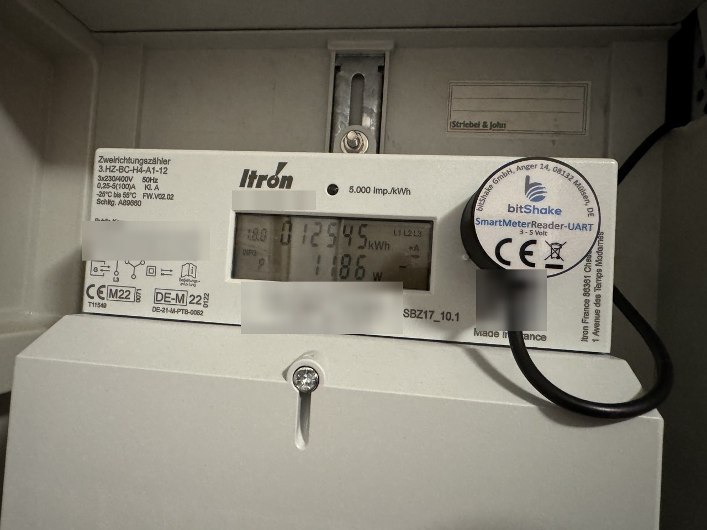

# Home Assistant Electricity Meter

[🇩🇪 Deutsch](README.md) · 🇬🇧 English

Documentation and example configurations for two Tasmota/ESP32 meter readers on the home network:

- Utility room: grid draw and grid feed-in at the Itron bidirectional meter with a bitShake SmartMeterReader-UART.
- PV system: PV generation of the 8 kW system with an ESP32-ETH01 / WT32-ETH01.



*Itron bidirectional meter in the utility room with the bitShake SmartMeterReader-UART attached. Serial numbers and codes are blurred.*

The goal is a wired integration of both meters into Home Assistant Energy at:

```text
http://<HOME_ASSISTANT_IP>:8123/energy/overview
```

<br>
<a href="https://www.buymeacoffee.com/thoralf.brandt" target="_blank">
  
</a>
<br>

## Inventory

| Task | IP | Hardware | Firmware | Readings |
| --- | --- | --- | --- | --- |
| Utility room grid meter | `<HWR_TASMOTA_IP>` | currently Tasmota/Wi-Fi, switch to ESP32-ETH01 planned | Tasmota | Draw, current power, feed-in |
| PV generation | `<PV_TASMOTA_IP>` | WT32-ETH01 / ESP32-ETH01 | Tasmota | PV draw/meter reading, PV power, total PV generation |

The bitShake UART reading head works with 3 to 5 V and sends the SML data serially to the ESP32.

Example Tasmota MQTT topics:

- Utility room: `<HWR_TASMOTA_TOPIC>`
- PV system: `<PV_TASMOTA_TOPIC>`

When moving the utility room adapter to a new ESP32-ETH01 board, set the topic deliberately, e.g. to a descriptive `stromzaehler_hwr`. The Home Assistant YAML must match the topic.

## Relevant references

- ESPHome can read SML directly over UART; to find the OBIS codes, the docs recommend the debug logs of the SML component. See [ESPHome SML](https://esphome.io/components/sml/).
- ESPHome supports wired Ethernet for ESP32 boards. See [ESPHome Ethernet](https://esphome.io/components/ethernet/).
- bitShake describes the Home Assistant connection via MQTT/Tasmota for the SmartMeterReader. See [bitShake Home Assistant support](https://www.bitshake.de/support/home-assistant/).
- Similar projects use ESPHome or Tasmota, UART/SML and Home Assistant, e.g. [Afraskai/ESPHome_smartmeter](https://github.com/Afraskai/ESPHome_smartmeter) and the Home Assistant community example [PoESP32 SML Meter](https://community.home-assistant.io/t/integrate-sml-meter-using-poesp32-replaces-volkszahler-rpi/928723).
- Home Assistant Energy expects long-term energy sensors with matching units and `state_class: total_increasing`. See [Home Assistant Electricity Grid](https://www.home-assistant.io/docs/energy/electricity-grid/).

## Wiring the ESP32-ETH01 to the bitShake UART

Recommended wiring for Tasmota SML on the ESP32-ETH01:

| bitShake SmartMeterReader-UART | ESP32-ETH01 / WT32-ETH01 |
| --- | --- |
| `VCC` / `3-5V` | `3V3` or a stable `5V`, depending on the board setup |
| `GND` | `GND` |
| `TX` of the reading head | `GPIO5` / ESP32 RX for Tasmota `+1,5,s,0,9600,...` |
| `RX` of the reading head | not needed, leave unconnected |

Notes:

- The reading head sends data, so its `TX` is connected to the ESP32's RX GPIO.
- The existing PV adapter uses GPIO `5` at 9600 baud.
- The ESP32-ETH01 needs a stable power supply. Even if the Ethernet board is powered with 5 V, only 3.3 V-compatible UART logic may reach the ESP32 pin. According to its label, the bitShake UART reader is suitable for 3 to 5 V.
- The reading head must sit exactly on the meter's optical interface (it is held magnetically). With the wrong orientation you get no or incomplete SML telegrams.

## OBIS codes

### Utility room / grid meter

From the existing Tasmota script:

| Value | OBIS | Tasmota field | Unit | Meaning |
| --- | --- | --- | --- | --- |
| Grid draw meter reading | `1-0:1.8.0*255` | `HWR_Pow.Total_in` | kWh | Energy from the grid |
| Current power | `1-0:16.7.0*255` | `HWR_Pow.Power_curr` | W | Instantaneous power |
| Grid feed-in meter reading | `1-0:2.8.0*255` | `HWR_Pow.Total_out` | kWh | Energy to the utility |

Live example from 2026-10-10:

```json
{
  "HWR_Pow": {
    "Total_in": 46317.3878,
    "Power_curr": 653,
    "Total_out": 38914.2942
  }
}
```

### PV system

From the existing ESP32-ETH01 script:

| Value | OBIS | Tasmota field | Unit | Meaning |
| --- | --- | --- | --- | --- |
| PV draw meter | `1-0:1.8.0*255` | `PV.PVB` | kWh | Secondary value in the PV meter |
| PV power | `1-0:16.7.0*255` | `PV.PVL` | W | Current PV power |
| Total PV generation | `1-0:2.8.0*255` | `PV.PVG` | kWh | PV energy generated |

Live example from 2026-10-10:

```json
{
  "PV": {
    "PVB": 278.7192,
    "PVL": 3,
    "PVG": 69187.8713
  }
}
```

## Setting it up with Tasmota

1. Flash the ESP32-ETH01 with Tasmota32, ideally with scripting/SML support.
2. Configure Ethernet, e.g. via the web interface or the Tasmota console.
3. Connect the reading head: `TX` of the bitShake UART reader to GPIO5, common `GND`, connect power.
4. Enter the script under `Tools -> Edit Script`.
5. Enable `Script enable` and save.
6. Run `Sensor53 r` in the console or restart.
7. Check at `http://<ip>/cm?cmnd=Status%2010` whether the values appear.
8. Configure MQTT to `<MQTT_HOST>:1883`.
9. Create the MQTT sensors in Home Assistant.
10. Select the grid/PV sensors in Home Assistant Energy.

## Home Assistant Energy mapping

In Home Assistant under `Settings -> Dashboards -> Energy`:

- Grid consumption: `sensor.hwr_netzbezug_total`
- Return to grid: `sensor.hwr_netzeinspeisung_total`
- Solar production: `sensor.pv_erzeugung_total`

Instantaneous power values such as `Power_curr` or `PVL` are useful for dashboards, but Energy needs the cumulative kWh meter readings.

## Files

- [`tasmota/pv-esp32-eth01.script`](tasmota/pv-esp32-eth01.script): cleaned-up script for the existing PV adapter.
- [`tasmota/hwr-stromzaehler-esp32-eth01.script`](tasmota/hwr-stromzaehler-esp32-eth01.script): script for the grid meter after moving to the ESP32-ETH01.
- [`homeassistant/mqtt-sensors.yaml`](homeassistant/mqtt-sensors.yaml): MQTT sensors for Home Assistant.
- [`docs/umbau-esp32-eth01.md`](docs/umbau-esp32-eth01.md): detailed conversion guide (German).

## Security

This repository is public. API keys, MQTT passwords and pvoutput.org keys do not belong in the repo. The example scripts therefore contain placeholders.
